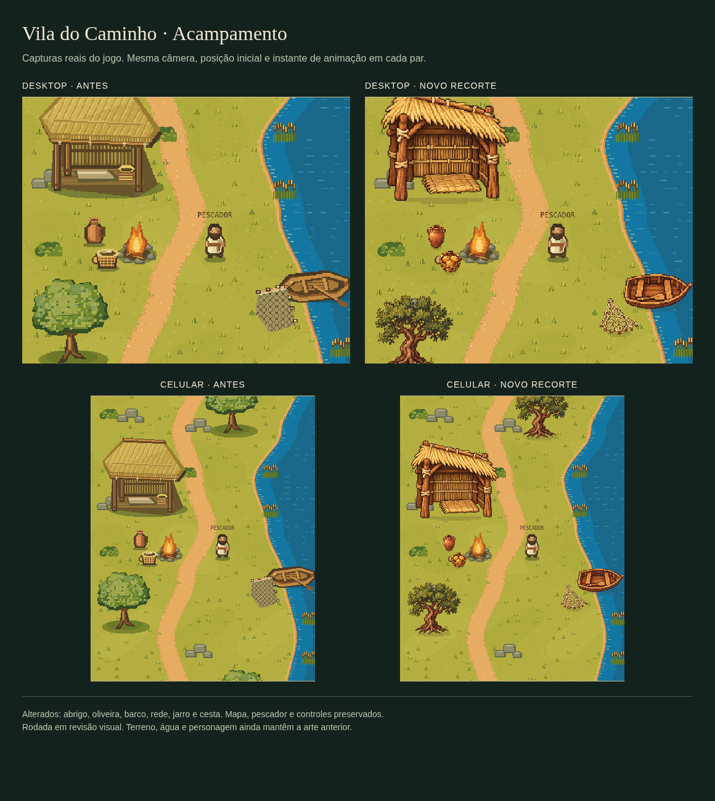
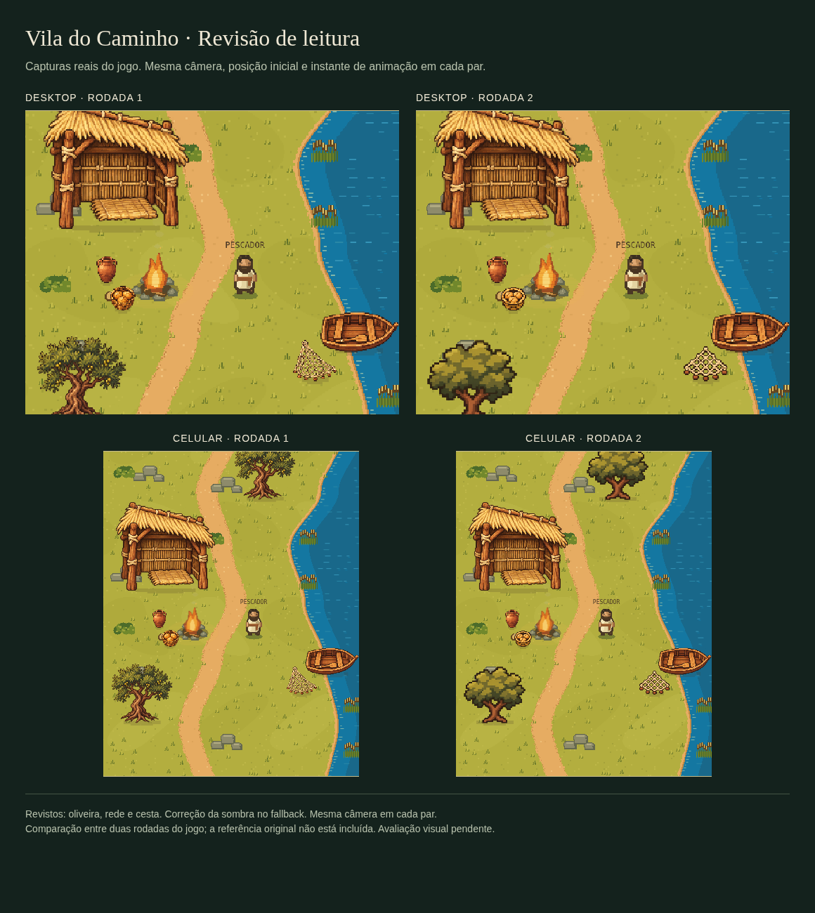

# Acampamento — primeira rodada de objetos

A arte procedural anterior ficou distante da referência aprovada. Esta rodada substitui seis objetos no jogo real: abrigo de junco/palha, oliveira, barco, rede, jarro e cesta. Não redesenha o mapa nem representa a finalização de todo o cenário.

Base: `main@91d4c1dc2d8858fe997d15ada8afa138d284949d`.
Responsável: Codex, frente visual e integração. Branch: `codex/camp-visual-pass`.
Estado: implementação e QA concluídos; avaliação visual do usuário pendente. Sem merge, deploy ou Motion nesta rodada.

## Implementação

- Folha RGBA local de seis objetos, preservada sem edição dos bytes. Origem e hash em `public/assets/shore-kit.json` e `THIRD_PARTY_NOTICES.md`.
- Recortes separados pelo adapter, proporção preservada, alinhamento pela base e dimensões de mundo inteiras. Rasterização intermediária evita detalhe subpixel diferente entre desktop e celular; cache limitado a 32 variantes.
- Jarro, cesta, barco e rede receberam ajustes apenas de tamanho visual. Sombras discretas de contato ancoram os objetos. Coordenadas e colisões continuam iguais.
- O cache das árvores distantes é renovado uma vez quando o kit termina de carregar.
- Recursos vêm apenas da própria aplicação, sem API, credenciais ou dependência nova. Se a leitura/decodificação falhar, permanece o atlas procedural.

## Verificação

- `node --test tests/*.test.cjs`: 26 testes passaram.
- `node --check public/world.js` e `node --check public/visual-assets.js`: sintaxe válida.
- `node tools/tokens/build.cjs --check`: arquivos gerados dos tokens em dia.
- Comparação antes/depois com tempo de animação fixo em 1,0 s, posição inicial e câmera `(11,16,1.05)`, viewports 1280×1000 e 390×844, DPR 1. O enquadramento difere entre dispositivos pela proporção do canvas, mas é idêntico dentro de cada par.
- Navegador Chromium: carregamento, movimento, restauração local, modo de exploração, retorno ao pescador, controles e fallback por falha simulada de asset. Registro em `camp-browser-qa.json`.
- Revisão independente comparou o JS com a base: estado, morador, mapa, colisões, allowlist, câmera, desenho do personagem e controles idênticos. Diferenças restritas ao desenho de objetos e ao cache visual; inclusão do adapter no HTML.

## Limites e próxima passagem

Terreno, água, rochas, fogo e personagem ainda têm a arte anterior. A oliveira nova tem detalhes mais finos que a copa da referência; a coerência da vegetação e da escala ainda exige avaliação. Não alegamos quantização exata às cores dos tokens nem aprovação de fidelidade final. Os tokens medidos da referência continuam sendo direção, não prova de equivalência de pixels.

Próximo responsável: direção visual, após comentário do usuário sobre esta comparação. Próxima ação concreta: alinhar terreno/vegetação e personagem ao acabamento do acampamento, preservando a geometria e a cronologia. Não produzir o episódio 1 aqui: Claude conduz esse artefato em tarefa independente. Não implantar esta branch automaticamente.

## Revisão 2 — leitura e fallback

A revisão independente identificou detalhe excessivo na oliveira e leitura fraca da rede/cesta no celular. Esses três objetos usam agora uma segunda folha: copa em blocos maiores, tronco simples, malha aberta e pães separados. Abrigo, barco e jarro mantêm os bytes e recortes anteriores. A comparação é entre duas rodadas reais do jogo, sem a referência original ao lado; não comprova fidelidade integral nem aprovação final.

A sombra foi movida para o raster transparente do objeto. Sombra e sprite chegam ao destino em uma única chamada; falhas anteriores ao desenho não deixam sombra residual antes do fallback. O adapter aceita `sprite.image` opcional, valida os caminhos e os recortes contra a folha correta, decodifica cada URL uma vez e ativa o conjunto apenas quando todas as imagens estão prontas. O cache continua limitado a 32 variantes.

Verificação atual: **31 testes passaram**. Capturas desktop/mobile sem erros JavaScript e sem overflow. Em Chromium, uma falha simulada na folha adicional e outra no desenho final produziram fallback com SHA-256 de pixels idêntico; registro em `camp-fallback-regression.json`. O registro das capturas está em `camp-browser-qa-v2.json`. Uma segunda revisão visual confirmou melhor leitura dos três objetos, com a ressalva de não ter a referência original local para comparação direta.

A limitação de ruído fino da oliveira descrita na rodada 1 foi tratada nesta revisão; terreno, água, fogo, rochas e personagem seguem com a arte anterior. Estado, câmera e controles permanecem fora deste ajuste. Avaliação visual pendente; nenhum merge, deploy ou novo Reel.
