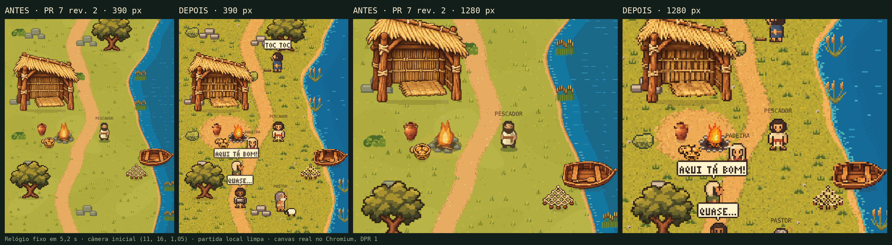

# Arte v3, passo 1 — terreno, personagens e vida na vila

Base: `codex/camp-visual-pass@baa6d16` (PR #7 com a revisão 2, incorporada por merge). Responsável: Claude, frente visual, a pedido do proprietário em 02/11/2026 ("Você segue dele"), com a direção nova: mais animado, engraçado e atraente, com moradores novos já chegados. Branch: `claude/visual-v3-step1`. Sem merge, deploy ou Motion nesta rodada.

## O que mudou (só `public/world.js` e os tokens gerados)

- **Pixel de arte único de 2 px de mundo** em terreno, personagens, fogo e cenário. Os seis objetos do acampamento passam por `spriteArt`: o `sprite()` do PR #7, sem nenhuma alteração, desenha cada objeto uma vez em meia resolução num raster em cache, já com a sombra de contato do adapter, e esse raster é ampliado 2×. Kit, adapter e fallback procedural continuam iguais e os contratos de atomicidade do PR #7 seguem valendo.
- **Paleta `P`** trocada pelas rampas medidas da referência aprovada, mesmas chaves e mais 19 cores nomeadas para a arte nova.
- **Terreno** gerado por célula de arte (ImageData): grama em dois tons com tufos e pedrinhas, trilha com borda em degrau e aro mais escuro, faixa de areia com beira molhada, linha d'água turquesa, água com espuma e marolas animadas só dentro da câmera. A clareira de terra do acampamento é visual.
- **Pescador e visitante** redesenhados como mapas de pixel (16 × 24 de arte, 4 direções × 3 quadros), na proporção da referência. A sombra saiu do quadro do atlas e virou sombra de contato no chão.
- **Fogo, pedras, juncos, arbusto, pão e fogueira** redesenhados no mesmo grão.
- **Vida na vila (capítulo 2):** pastor com ovelha fujona, carpinteiro que acerta o dedo, pedreiro com a pedra grande, agricultora que planta no meio da trilha e padeira com pão quentinho. Cada um tem rota curta e uma gag com balão em fonte de pixel própria (3 × 5, com acentos). Também entraram peixe pulando, pássaros, borboletas e piscar de olhos.
  - É uma camada decorativa, função pura do tempo, e não mexe no estado canônico. `residents` continua `['pescador1']`, e colisão, contratos e cronologia seguem iguais.
  - `state.folk` substitui a camada quando um diretor roteiriza a cena, como no Ep. 2. `options.folk === false` desliga.

## Verificação

- `node --test tests/*.test.cjs`: 31 de 31 passaram, incluindo os 5 testes novos do adapter na revisão 2.
- `node --check public/world.js` e `node --check public/visual-assets.js`: sintaxe válida.
- `node tools/tokens/build.cjs --check`: tokens/dist em dia.
- Tokens regerados pelo mesmo pipeline do PR #2: captura do runtime, análise, comparação com a referência e montagem.

| distância à referência (ΔE2000) | antes | depois |
| --- | --- | --- |
| P do runtime: mediana | 4,19 | 1,39 |
| P do runtime: cores com ΔE < 5 | 79,2% | 92,5% |
| tudo que o runtime desenha: mediana | 3,85 | 1,37 |

- **Capturas determinísticas** (relógio fixo em 5,2 s, câmera inicial, partida limpa) em 390 × 844 e 1280 × 1000 com DPR 1, e em 375 × 812 e 1440 × 900 com DPR 2.
  - Nenhum erro de console, kit `ready` e sem rolagem horizontal.
  - Intervalo mediano entre quadros de 16,7 ms (60 fps) no Chromium headless, igual ao PR #7 rev. 2.
- **Geometria inalterada:** `SHORELINE`, `TRAIL`, `OBSTACLES`, `isBlocked`, `CELLS` e o manifesto de assets são os mesmos.

## Não verificado

- iPhone físico e Android de entrada: o desempenho no aparelho real ainda precisa de uma passada.
- Leitura dos balões em telas muito pequenas e com zoom mínimo.
- A vista lateral dos personagens é simplificada e pode ganhar um passe próprio.

## Próximo passo

Revisão do Codex e avaliação visual do Alex. Se aprovado, o ideal é publicar junto com o Ep. 2 (03/11, por volta das 20h): os moradores novos são justamente o capítulo 2.
